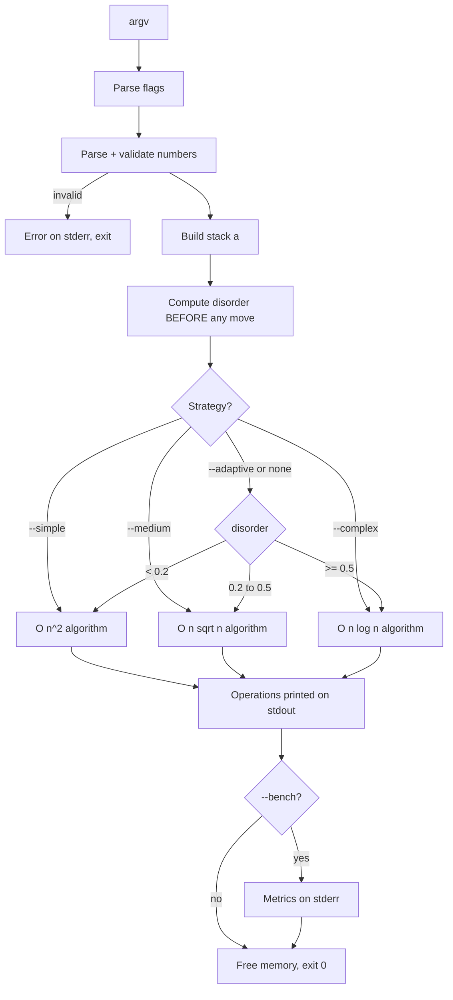

*This project has been created as part of the 42 curriculum by \<login1\>, \<login2\>.*

# push_swap — Learning Course and Implementation Guide

> Based on the official subject **Push_swap v1.2** ("Because Swap_push doesn't feel as natural").
> The subject is the single source of truth. Anything not stated in it is labeled **[Recommendation]** or **[Ambiguity]**.

---

## Table of Contents

1. [Subject analysis](#1-subject-analysis)
2. [Introduction and project overview](#2-introduction-and-project-overview)
3. [Theoretical foundations](#3-theoretical-foundations)
4. [Step-by-step implementation guide](#4-step-by-step-implementation-guide)
5. [Project structure](#5-project-structure-and-file-organization)
6. [Key functions, algorithms and data structures](#6-key-functions-algorithms-and-data-structures)
7. [Compilation and execution](#7-compilation-and-execution)
8. [Testing and debugging strategy](#8-testing-and-debugging-strategy)
9. [Evaluation and defense preparation](#9-evaluation-and-defense-preparation)
10. [Troubleshooting](#10-troubleshooting)
11. [Learning resources](#11-learning-resources)
12. [Mandatory README content for your repository](#12-mandatory-readme-content-for-your-repository)
13. [Academic integrity and AI usage](#13-academic-integrity-and-ai-usage)
14. [Final verification](#14-final-verification)

---

## 1. Subject analysis

### 1.1 Mandatory requirements (extracted from the subject)

| # | Requirement | Source section |
|---|-------------|----------------|
| M1 | Written in **C**, following the **Norm**. Norm errors (including in bonus files) = **0**. | Common Instructions |
| M2 | No unexpected crash (segfault, bus error, double free...). Crash = project non-functional = 0. | Common Instructions |
| M3 | All heap memory freed. No leaks. | Common Instructions |
| M4 | Makefile using `cc` with `-Wall -Wextra -Werror`. Rules: `$(NAME)`, `all`, `clean`, `fclean`, `re`. **Must not relink.** | Common Instructions, VI.5 |
| M5 | **Group project: exactly 2 learners**, both contribute, both can explain any part. README must indicate both contributions; both logins in the repository. | VI.1, IX |
| M6 | Program named `push_swap`. Files: `Makefile`, `*.h`, `*.c`. | VI.5 |
| M7 | Allowed external functions: `read`, `write`, `malloc`, `free`, `exit`, and `ft_printf` or an equivalent **you coded**. Libft authorized. | VI.5 |
| M8 | **Global variables forbidden.** | VI.5 |
| M9 | Input: list of integers, first argument = top of stack a. | VI.5 |
| M10 | Optional strategy selector: `--simple`, `--medium`, `--complex`, `--adaptive` (default when none given). | VI.5 |
| M11 | Output: operations separated by `\n` and nothing else, on stdout. | VI.5 |
| M12 | No parameters → print nothing, return the prompt. | VI.5 |
| M13 | Errors → `Error\n` on **stderr** (non-integer, out of int range, duplicates...). | VI.5 |
| M14 | Four strategies embedded in one binary: Simple O(n²), Medium O(n√n), Complex O(n log n), Adaptive. | VI.3, VI.5 |
| M15 | Selector must work for **any** input size/disorder. | VI.5 |
| M16 | Disorder metric computed **before any move**, using the pair-counting definition. | VI.3.2 |
| M17 | Adaptive regimes: `<0.2` → O(n²); `0.2 ≤ d < 0.5` → O(n√n); `≥ 0.5` → O(n log n). | VI.3.3 |
| M18 | `--bench` mode on **stderr**, only when the flag is present: disorder (% with 2 decimals), strategy name + complexity class, total ops, count of each of the 11 op types. | VI.5 |
| M19 | Benchmarks: 100 numbers `< 2000` ops (pass), 500 numbers `< 12000` ops (pass). | VI.6 |
| M20 | Complexity claims are measured in **number of push_swap operations generated**, not classic array complexity. | VI.3.1 |
| M21 | Repo README: first line italic `This project has been created as part of the 42 curriculum by <login1>[, <login2>]`, plus Description, Instructions, Resources (with AI usage), algorithm justification, and for adaptive: threshold rationale, techniques per regime, complexity argument (time + space). | VII, VI.3.3 |

### 1.2 Bonus (only evaluated if mandatory is *perfect*)

- `checker` program (`bonus` Makefile rule, files in `_bonus.{c/h}`).
- "Perfect" means **all benchmarks validated without exception**, including the "good" and "excellent" ones? The subject says "validating all benchmarks without exception". **[Ambiguity]** — see 1.4.

### 1.3 Performance thresholds

| Input | Pass (minimum) | Good | Excellent |
|-------|----------------|------|-----------|
| 100 random | < 2000 | < 1500 | < 700 |
| 500 random | < 12000 | < 8000 | < 5500 |

### 1.4 Ambiguities and gaps in the subject (do not silently assume!)

1. **Bench output format is not shown.** The usage examples for `--bench` are empty in the PDF. Only the *content* is specified. Choose a clear format and ask staff if unsure.
2. **Which strategy must hit the benchmarks?** Default is `--adaptive`, and random input has disorder ≈ 0.5, so the adaptive algorithm will mostly use its high-disorder method. The subject does not say whether `--simple` on 500 numbers must stay under 12000 (a pure O(n²) will not). Prepare to explain this.
3. **Benchmark vs. complexity class tension.** The subject demands the *claimed class be valid*. A well-tuned chunk algorithm may beat radix on operations count but is O(n√n) not O(n log n). Be honest in your README about which class each algorithm really belongs to.
4. **"O(n²) time" for low disorder:** is it "exactly" or "at most"? An algorithm that is faster on nearly sorted input is still O(n²) as an upper bound. **[Recommendation]** document it as an upper bound.
5. **Flag handling not specified:** unknown flags, several flags at once, `--bench` combined with a strategy, flag position among numbers. Decide, document, and handle without crashing. **[Recommendation]**: accept flags anywhere before/among the numbers, treat unknown `--xxx` as `Error`.
6. **Quoted single argument** (`"3 2 1"`): not mentioned for push_swap. Many peers expect it. **[Recommendation]** support it via a split, but it is not required by the subject.
7. **"smallest list possible"**: there is no exact minimum required; the evaluation is by benchmark thresholds.
8. **Example inconsistency:** the example section says a sequence sorts in 12 operations, while the usage example prints 16 operations for the same input. Treat both only as illustrations.
9. **Valid range:** "integers outside the valid range" — interpreted as the 32-bit `int` range (`-2147483648` to `2147483647`). **[Recommendation]** confirm with staff.
10. **Already sorted / 1 element:** nothing is stated; the natural behavior is to print nothing and exit successfully.

---

## 2. Introduction and project overview

### 2.1 What the project is

You get a list of distinct integers loaded into **stack a**; **stack b** is empty. You may only use 11 operations (swap, push, rotate, reverse-rotate). Your C program `push_swap` must **print a sequence of these operations that leaves stack a sorted ascending (smallest on top) and b empty**, using as few operations as possible.

### 2.2 Main objective

Discover **algorithmic complexity** concretely: sorting is easy with random access, but with two stacks and restricted moves, the *choice of algorithm* decides whether you need 700 or 12 000 operations. You will also learn that sorting an almost sorted list and a random list are very different problems.

### 2.3 What you will learn

- Measuring complexity in a custom cost model (operations, not CPU steps).
- Selection/insertion-style sorts (O(n²)), chunk/bucket sorts (O(n√n)), radix/quick/merge-style sorts (O(n log n)).
- Measuring "how unsorted" data is (disorder metric) and **adapting** the algorithm.
- Data structures in C (stacks as arrays or linked lists), memory management without leaks.
- Robust input parsing and error handling.
- Teamwork (exactly 2 learners) and responsible AI usage.

### 2.4 What you are expected to build

- `push_swap` with 4 strategies + `--bench` mode (mandatory).
- A `README.md` with algorithm justification (mandatory).
- `checker` (bonus).

### 2.5 General workflow



---

## 3. Theoretical foundations

### 3.1 Stacks and the 11 operations

**What:** A stack is a sequence where you normally access only the top. Here, both stacks also support rotations, so you can reach the bottom cheaply.
**Why/what problem:** The restricted operations force you to *plan* your moves rather than index into an array.

| Op | Effect |
|----|--------|
| `sa` / `sb` | swap top two of a / b (no-op if < 2 elements) |
| `ss` | `sa` + `sb` (counts as **1** operation) |
| `pa` | move top of b onto a (no-op if b empty) |
| `pb` | move top of a onto b (no-op if a empty) |
| `ra` / `rb` | rotate up: top becomes bottom |
| `rr` | `ra` + `rb` (1 operation) |
| `rra` / `rrb` | reverse rotate: bottom becomes top |
| `rrr` | `rra` + `rrb` (1 operation) |

Example on `a = [2, 1, 3]` (top first):
`sa` → `[1, 2, 3]`; `ra` on `[1,2,3]` → `[2,3,1]`; `rra` on `[1,2,3]` → `[3,1,2]`.

**Common mistakes**
- Rotating the wrong way (`ra` moves the *first* element to the end).
- Counting `rr` as two operations (the subject counts the printed lines; `rr` is one line).
- Forgetting the no-op rules (e.g. `pa` with empty b must change nothing; decide whether your program should print it — you should not generate such useless moves anyway).

**Defense questions**
- What does `rra` do to `[1,2,3,4]`? (→ `[4,1,2,3]`.)
- Why is `rr` cheaper than `ra` + `rb`? (One output line instead of two.)

### 3.2 Complexity in the push_swap model

**What:** Big-O describes how cost grows with input size `n`. Here the *cost is the number of printed operations*, not CPU time (subject VI.3.1).
**Why it matters:** A classic bubble sort is O(n²) comparisons, but its push_swap adaptation costs operations for every rotation/swap you print.

| Class | Meaning (in ops) | Rough ops for n = 500 |
|-------|------------------|------------------------|
| O(n²) | ~n²/c ops | tens of thousands |
| O(n√n) | ~c·n·22 ops | a few thousand to ~10 000 |
| O(n log n) | ~c·n·9 ops | ~ 5000–7000 |

(n = 500: √n ≈ 22, log₂ n ≈ 9. Constants matter in practice; these rows are orders of magnitude only.)

**Misconceptions**
- "My algorithm is O(n log n) because it's *named* merge/quick sort." It is only valid if the **operations generated** grow as n log n. Rotating a stack to reach an element costs O(n) ops, which can silently turn a "log n" algorithm into something worse.
- Big-O hides constants; benchmark thresholds are constant-sensitive.

**Defense questions**
- Why does radix sort give O(n log n) ops here? (Each pass costs ~n operations; the number of passes is the number of bits of the largest index, ≈ log₂ n.)
- How do you prove your medium algorithm is O(n√n)? (See 6.5.)

### 3.3 Index normalization (a.k.a. coordinate compression)

**What:** Replace each value by its **rank** (0 = smallest, n-1 = largest) in a copy of the sorted values.
**Why:** Sorting algorithms like radix sort need small, dense, non-negative integers. Ranks make negative numbers and huge gaps irrelevant.
**How:** Copy values to an array, sort the copy (any simple method — allowed since it is not the push_swap output; just avoid forbidden functions such as `qsort` which are *not* in the allowed list!), then each element's rank is its position in the sorted copy (or count how many elements are smaller: O(n²) but fine, or binary search).

Example: `[40, -3, 10, 99]` → ranks `[2, 0, 1, 3]`.

**Warning:** `qsort`, `sort`, etc. are not in the allowed external functions list. Write your own sort for the copy (e.g. insertion sort or the O(n²) rank-counting method).

### 3.4 The disorder metric

**Definition (subject):** `disorder = mistakes / total_pairs` where, over all pairs `i < j`, a *mistake* is `a[i] > a[j]` (an **inversion**).

| Input | mistakes | total | disorder |
|-------|----------|-------|----------|
| `1 2 3 4` | 0 | 6 | 0.0 |
| `4 3 2 1` | 6 | 6 | 1.0 |
| `2 1 3 4` | 1 | 6 | 0.1667 |
| random | ≈ half | | ≈ 0.5 |

**Rules and pitfalls**
- Must be computed **before any move** (subject).
- It is O(n²) to compute — acceptable since this is CPU work, not push_swap operations.
- With n ≤ 1: `total_pairs = 0` → **division by zero**. Handle it (disorder = 0).
- **[Recommendation]** avoid floating point: `d < 0.2 ⇔ mistakes * 5 < total`, `d < 0.5 ⇔ mistakes * 2 < total`. For `--bench` printing with 2 decimals, use integer math: `mistakes * 10000 / total` gives hundredths of a percent; print `X.YY%`. (Use `long` to avoid overflow with large `n`.)
- Thresholds at exactly 0.2 / 0.5 belong to the *higher* regime (`0.2 ≤ d < 0.5`, `d ≥ 0.5`).

### 3.5 Algorithm families you can adapt

**O(n²) — selection/insertion style.**
- *Selection:* repeatedly bring the minimum to the top of a (via `ra`/`rra`, whichever is shorter), `pb` it; finally `pa` everything back. Each of the n extractions costs ≤ n/2 rotations → O(n²).
- *Insertion:* push elements into b while keeping b ordered, choosing cheapest rotation. Also O(n²).

**O(n√n) — chunk/bucket style.**
1. Normalize to ranks.
2. Split ranks into ~√n ranges (chunks).
3. Push elements of the first chunk to b, then second, etc. (rotating a to find them).
4. Bring back from b to a in descending order: always bring the current maximum to the top of b (`rb`/`rrb`, shortest direction), `pa`.
Why it works: after step 3, b is roughly sorted by chunk, so the next maximum is never far from the top.

**O(n log n) — radix / quick / merge style.**
- *LSD radix (binary):* for each bit `k` from 0 to ⌈log₂ n⌉-1: for each of the `n` elements of a, if bit `k` of its rank is 0 → `pb`, else `ra`. Then `pa` everything back. After the last bit, a is sorted. Cost ≈ passes × (n + |b|) operations.
- *Quicksort on stacks:* partition around a pivot (median) by pushing smaller elements to b and recursing. Needs careful handling of rotations to keep log-depth cost.
- *Merge sort:* split between stacks and merge back; merging with only top access is natural for stacks.

**Worked check of radix:** n = 100 → ranks 0..99 → 7 bits → ≈ 7 × (100 + ~50) ≈ 1050 ops (passes "pass" and "good" for 100, not "excellent < 700"). For n = 500 → 9 bits → ≈ 9 × 750 ≈ 6750 (matches the 6784 shown in the subject; passes and "good", not "excellent < 5500"). **To reach "excellent" you will likely need a smarter algorithm** (e.g. chunking with minimal rotations, combined `rr`/`rrr`, smarter pivots). This is an inference from arithmetic, not a statement of the subject — measure your own results.

### 3.6 Combining operations (`rr`, `rrr`, `ss`)

If you need `ra` **and** `rb` at the same time, printing `rr` saves one operation. Strategy: either (a) make your algorithm aware of it, or (b) post-process the operation list and merge adjacent `ra`+`rb` (and `rb`+`ra`, `rra`+`rrb`, `sa`+`sb`) pairs. Option (b) requires storing operations (O(#ops) memory) before printing.

### 3.7 Cancelling redundant operations

`pa` immediately followed by `pb` (or vice-versa) cancels. `ra` followed by `rra` cancels. A peephole pass removing these can shave operations.

### 3.8 C concepts needed

| Concept | Why you need it here |
|---------|----------------------|
| `malloc`/`free` | stacks, rank array, op buffer. Free on **every** exit path, including `Error`. |
| Pointers & linked lists *or* arrays | stack representation (see 6.1). |
| `long`/overflow | parse `INT_MIN`..`INT_MAX` safely: parse in `long long`, check range *during* accumulation. |
| Passing by pointer/struct | no global variables allowed → carry state in a struct. |
| `read`/`write` | I/O; `ft_printf` only if you wrote it (checker needs `read`). |
| `stdout` vs `stderr` | `write(1, ...)` for ops, `write(2, ...)` for `Error` and bench. |
| Makefile/relink | objects as prerequisites; `.PHONY`. |

**Common memory mistakes:** freeing nodes twice when moving them between stacks (move nodes, don't copy + free); leaking on an `Error` after partially building the list; forgetting to free the split array from a quoted argument.

---

## 4. Step-by-step implementation guide

Work in this order. Do not skip checkpoints. Split work with your partner **[Recommendation]**: one person does parsing + ops + bench + checker, the other does the algorithms — but **both** must understand everything (M5).

### Phase 0 — Repository, Makefile, team setup

- **Objective:** a compiling skeleton and a shared repo.
- **Theory:** Makefile dependency rules, relinking.
- **Implementation:** create the structure of §5; Makefile with `NAME`, `all`, `clean`, `fclean`, `re` (+ `bonus`), flags `-Wall -Wextra -Werror`, compiler `cc`; compile libft through its own Makefile if you use it.
- **Expected:** `make` builds an empty `push_swap`; running `make` again prints "nothing to be done" (no relink).
- **Testing:** `make && make` (second must not recompile), `make fclean && make`.
- **Common errors:** no relink protection when `.o` files are not prerequisites of `$(NAME)`; wildcards (`*.c`) are discouraged in 42 Makefiles **[Recommendation]**.
- **Checkpoint:** [ ] builds with flags [ ] no relink [ ] both logins in repo [ ] norminette passes.

### Phase 1 — Argument parsing and validation

- **Objective:** turn `argv` into a validated list of ints and a strategy selection; print `Error\n` to stderr otherwise.
- **Theory:** `int` range, overflow, strings → numbers by hand (no `atoi` usage required; and `atoi` cannot report errors).
- **Implementation:**
  1. No arguments → return 0, print nothing (M12).
  2. Detect flags: `--simple`, `--medium`, `--complex`, `--adaptive`, `--bench`.
  3. For every other argument: optional sign, ≥ 1 digit, only digits, value within `[INT_MIN, INT_MAX]`.
  4. Detect duplicates (O(n²) is fine, or compare after ranking).
  5. On any error: free everything, `write(2, "Error\n", 6)`, exit.
- **Code example (range-safe parsing idea):**

```c
/* Returns 1 on success and stores the value in *out. Returns 0 on error. */
int	parse_int(const char *s, int *out)
{
	long	n;
	int		sign;
	int		i;

	i = 0;
	sign = 1;
	if (s[i] == '+' || s[i] == '-')
		if (s[i++] == '-')
			sign = -1;
	if (!s[i])
		return (0);
	n = 0;
	while (s[i] >= '0' && s[i] <= '9')
	{
		n = n * 10 + (s[i++] - '0');
		if (n * sign > 2147483647L || n * sign < -2147483648L)
			return (0);
	}
	if (s[i])
		return (0);
	*out = (int)(n * sign);
	return (1);
}
```
*(Illustrative; it is not Norm-compliant — you must split/reshape it to satisfy the Norm.)* The check inside the loop prevents `long` overflow because `n` never exceeds ~2.1 billion before the check fires.

- **Expected:** valid inputs build a list; invalid inputs print `Error`.
- **Testing:** see §8.2.
- **Common errors:** `"-"`, `"+"`, `""`, `"1 2"` as a single argument without splitting, `"--"` confusion with a negative number, `"2147483648"`, `"-2147483649"`, `"0"` vs `"-0"` vs `"00"` duplicates (they are the same value → duplicate → Error).
- **Checkpoint:** [ ] all error classes detected [ ] no leaks on error paths [ ] `Error` on **stderr**.

### Phase 2 — Stack data structure

- **Objective:** a representation for a and b supporting the 11 ops cheaply, **without global variables**.
- **Theory:** see §6.1 (array vs circular buffer vs doubly linked list).
- **Implementation:** a `t_stack` struct and a `t_ctx` struct (stack a, stack b, size n, op counters, selected strategy, bench flag, optional op buffer). Pass `t_ctx *` everywhere.
- **Expected:** you can build stack a from the parsed values and print its contents.
- **Testing:** debug-print helper (remove or hide before submission).
- **Common errors:** losing the head pointer after rotation; forgetting to update `size`; circular list off-by-one.
- **Checkpoint:** [ ] create/destroy stacks [ ] no leaks (valgrind).

### Phase 3 — Implement the 11 operations

- **Objective:** each operation mutates the stacks **and** records/prints itself.
- **Theory:** §3.1.
- **Implementation:** one function per operation (or generic helpers: `push(from, to)`, `swap(s)`, `rotate(s)`, `rrotate(s)`). A single `exec(ctx, op)` that applies and counts. Decide **print immediately** vs **buffer then print** (buffering enables the `rr` merge optimization).
- **Code example (pseudocode for `pb`):**

```text
pb(ctx):
    if a is empty: return (and do not emit an op)
    node = pop_top(a)
    push_top(b, node)
    emit("pb")
```
- **Expected:** a hardcoded sequence reproduces the subject's example (`sa`, `pb pb pb`, `rr`, `rrr`, `sa`, `pa pa pa`).
- **Testing:** replay the example from VI.4 and compare stack states step by step.
- **Common errors:** emitting an op that did nothing; rotating the wrong direction; `ss/rr/rrr` applying only to one stack.
- **Checkpoint:** [ ] each op unit-tested alone [ ] counters correct.

### Phase 4 — Disorder computation

- **Objective:** compute disorder from the initial a, before any move.
- **Theory:** §3.4.
- **Implementation:** array snapshot of stack a; double loop counting inversions; store `mistakes` and `total`. Keep both integers so thresholds can be tested without floats.
- **Expected:** `2 1 3 4` → 1/6 ≈ 16.67 %.
- **Testing:** sorted, reversed, one element, two elements, random.
- **Common errors:** division by zero when n ≤ 1; computing after pushes; using `int` for `total` with big n.
- **Checkpoint:** [ ] matches hand-calculated examples [ ] edge sizes safe.

### Phase 5 — Index normalization

- **Objective:** replace values by ranks `0..n-1`.
- **Theory:** §3.3.
- **Implementation:** keep original values only for the final check/debug; algorithms work on ranks.
- **Expected:** `[40,-3,10,99]` → `[2,0,1,3]`.
- **Checkpoint:** [ ] ranks form a permutation of 0..n-1 [ ] works with negatives/INT_MIN/INT_MAX.

### Phase 6 — Simple strategy, O(n²) (`--simple`)

- **Objective:** a correct baseline; correctness before efficiency.
- **Theory:** selection sort adaptation (§3.5, §6.3).
- **Implementation:** repeat while a has > 0 (or > 3, with a tiny hard-coded sort for 3) elements: find min, rotate by shortest path, `pb`; then `pa` everything.
- **Expected:** every input of every size becomes sorted; example `--simple 5 4 3 2 1` ends sorted.
- **Testing:** exhaustive permutations for n ≤ 6; random for larger; use `checker_linux` mentioned in the subject.
- **Common errors:** choosing the longer rotation direction; forgetting to `pa` back; mishandling duplicates (not possible — rely on validation).
- **Checkpoint:** [ ] 100% correct on all small permutations [ ] counts roughly n²/4 scale.

### Phase 7 — Medium strategy, O(n√n) (`--medium`)

- **Objective:** chunk sort (§6.4).
- **Implementation:** chunk size ≈ √n (**[Recommendation]**: for n = 500 try ~ 15–30; tune by measurement). Push chunk members to b; optionally rotate b (`rb`) for elements in the lower half of the chunk to pre-order b. Pull back by repeatedly bringing the max to the top of b.
- **Expected:** noticeably fewer ops than `--simple` on 100+ numbers.
- **Testing:** correctness first (checker), then count ops over many random runs.
- **Common errors:** chunk boundaries off by one; recomputing the max position in O(n) each time is fine CPU-wise but make sure *operations* stay low; tiny `n` where `√n` rounds to 0 — guard it.
- **Checkpoint:** [ ] correct for n = 1..10 [ ] correct for large n [ ] chunk-size rationale documented.

### Phase 8 — Complex strategy, O(n log n) (`--complex`)

- **Objective:** radix (or merge/quick) with provable n·log n operations (§6.5).
- **Implementation (radix):**

```text
radix(ctx):
    bits = number of bits of (n - 1)
    for k in 0 .. bits-1:
        repeat n times:
            if bit k of rank(top of a) is 0: pb
            else: ra
        while b not empty: pa
```
- **Expected:** a sorted after the last pass; ~1000 ops for n = 100, ~6700 for n = 500 (estimates, see §3.5).
- **Optimizations to consider (recommendation):** skip passes when a is already sorted; stop early if a is sorted; merge `ra`+`rb`; use a different base; or choose a different O(n log n) algorithm if you want "excellent" results.
- **Common errors:** looping `n` times but `a` shrinks (use the *initial size of a for this pass*, not the live size); forgetting the final `pa` loop; applying radix to raw (negative) values.
- **Checkpoint:** [ ] correct on random/reversed/sorted [ ] n = 1, 2, 3 safe [ ] complexity argument written.

### Phase 9 — Adaptive strategy

- **Objective:** choose the method from the measured disorder (M17).
- **Implementation:**

```text
adaptive(ctx):
    if disorder < 0.2:           low  -> O(n^2) method
    else if disorder < 0.5:      mid  -> O(n sqrt n) method
    else:                        high -> O(n log n) method
```
 The three internal methods can be your three previous strategies, but the subject says the adaptive design is *yours*; you may refine them (e.g. low regime: only push out-of-order elements into b and insert them back, which is still O(n²)).
- **Expected:** `--adaptive` (and no flag) produces the same result as the corresponding forced strategy for the same regime — or a better custom one.
- **Testing:** craft inputs of known disorder (see §8.3). Verify with `--bench` which strategy was used.
- **Common errors:** float comparisons at the boundaries; computing disorder after pushing; forgetting that the default (no selector) is adaptive.
- **Checkpoint:** [ ] thresholds respected exactly [ ] rationale for thresholds written in README.

### Phase 10 — Benchmark mode (`--bench`)

- **Objective:** print metrics to **stderr** only when `--bench` is given.
- **Required content:** disorder (% with two decimals), strategy name + complexity class, total ops, count of each of the 11 operations.
- **Suggested format [Recommendation — not in the subject]:**

```text
[bench] disorder:  49.87%
[bench] strategy:  Adaptive / O(n log n)
[bench] total_ops: 6784
[bench] sa: 0  sb: 0  ss: 0  pa: 2500  pb: 2500
[bench] ra: 900  rb: 0  rr: 0  rra: 884  rrb: 0  rrr: 0
```
- **Testing:** `./push_swap --bench $ARG >/dev/null` (shows metrics only); `./push_swap --bench $ARG 2>/dev/null | wc -l` (ops only, no bench text on stdout).
- **Common errors:** printing bench to stdout (breaks the checker); printing it without the flag; strategy name wrong when adaptive delegates (show the underlying method used — **[Recommendation]**: print both "Adaptive" and the chosen class).
- **Checkpoint:** [ ] stderr only [ ] counters equal `wc -l` of stdout [ ] works with every selector.

### Phase 11 — Optimization against the benchmarks

- **Objective:** meet VI.6 targets with margin on random inputs.
- **Method:** write a script that runs 100 numbers × 100–1000 trials and reports min/avg/max ops (and the same for 500). Optimize with data, not intuition: tune chunk size, add `rr/rrr` merging, shortest-direction rotations, small-size special cases (n = 2, 3, 4, 5).
- **Checkpoint:** [ ] worst case over many trials still below the **pass** thresholds [ ] aim for good/excellent **[Recommendation]**.

### Phase 12 — Robustness and cleanup

- Check memory on every path (valgrind), run `norminette`, remove debug prints, verify Makefile rules, verify that no global variable exists.

### Phase 13 — Bonus: `checker` (only if mandatory is perfect)

- **Objective:** execute operations read from stdin on the given stack; print `OK`/`KO` to stdout; `Error` on stderr.
- **Implementation:** parse args (same rules, **no strategy flags needed**), read lines with `read` (you need a line reader — `get_next_line`-style, written by you), validate each line against the 11 names (exactly, e.g. `"sa\n"`), apply, then check "a sorted and b empty".
- **Details from the subject:** no argument → stop and display nothing; `./checker "" 1` → `Error`; unknown/incorrectly formatted instruction → `Error`.
- **Files:** `_bonus.c/.h`; Makefile `bonus` rule; included in the Norm check.
- **Checkpoint:** [ ] `OK`/`KO`/`Error` cases of the subject [ ] works piped with push_swap [ ] no leaks.

---

## 5. Project structure and file organization

The subject only imposes: `Makefile`, `*.h`, `*.c` (and `README.md`). The layout below is a **recommendation**.

```text
push_swap/
├── Makefile
├── README.md
├── includes/
│   └── push_swap.h
├── libft/                  # optional (authorized); has its own Makefile
├── src/
│   ├── main.c              # entry, flag dispatch
│   ├── parse.c             # argument validation / int parsing
│   ├── stack.c             # stack creation/destruction/helpers
│   ├── ops_push_swap.c     # sa sb ss pa pb
│   ├── ops_rotate.c        # ra rb rr
│   ├── ops_rev_rotate.c    # rra rrb rrr
│   ├── disorder.c          # metric
│   ├── index.c             # rank normalization
│   ├── sort_simple.c       # O(n^2)
│   ├── sort_medium.c       # O(n sqrt n)
│   ├── sort_complex.c      # O(n log n)
│   ├── sort_adaptive.c     # regime selection
│   ├── bench.c             # --bench output
│   └── utils.c             # errors, frees
└── bonus/
    ├── checker_bonus.c
    ├── checker_bonus.h
    └── ...                 # *_bonus.c files
```

| File | Purpose | Required? |
|------|---------|-----------|
| `Makefile` | build with `cc -Wall -Wextra -Werror`; rules `NAME all clean fclean re` (+ `bonus`) | Mandatory |
| `*.h` | prototypes, structs, op enum | Mandatory |
| `*.c` | implementation | Mandatory |
| `README.md` | project doc (§12) | Mandatory |
| `libft/` | helpers; its Makefile compiled by yours | Optional |
| `*_bonus.{c,h}` | checker | Bonus |
| tests/scripts | your own testing | Optional (not graded) |

**Norm reminders** (general 42 knowledge — the subject only says "the Norm"; verify with `norminette`): functions are short (≤ 25 lines), few functions per file (≤ 5), limited parameters (≤ 4) and variables (≤ 5), no `for`, no ternary, declarations at the top of functions. Plan your decomposition accordingly from the start.

---

## 6. Key functions, algorithms and data structures

### 6.1 Stack representation

| Option | `sa` | `pa/pb` | `ra/rra` | Notes |
|--------|------|---------|----------|-------|
| Singly linked list | O(1) | O(1) | `ra` O(1) with tail ptr; `rra` O(n) | simple; `rra` needs a scan |
| **Doubly linked circular list** | O(1) | O(1) | O(1) both | fits the rotation ops well; careful pointers |
| Array with head offset (circular buffer) | O(1) | O(1) | O(1) | fixed capacity n for both stacks |

These costs are **CPU** costs; the *push_swap cost* of every op is 1 regardless. The structure only affects speed of your program, not the number of generated operations.

### 6.2 `compute_disorder`

- **Input:** array/list snapshot of a. **Output:** `mistakes`, `total_pairs`.
- **Pre:** called before any operation. **Post:** a unchanged.
- **Complexity:** time O(n²) CPU, space O(1) (or O(n) if snapshotting).
- **Edge cases:** n < 2.
- **Independent test:** compare with a hand-computed small case.

### 6.3 Simple strategy (selection) — cost argument

```text
while a not empty:
    p = position of min in a
    if p <= size/2: ra  p times
    else:           rra (size - p) times
    pb
while b not empty: pa
```
Each of n iterations costs ≤ n/2 rotations + 1 push; total ≤ n²/2 + 2n ⇒ **O(n²)** operations. Space: O(1) extra (stacks hold n elements).

### 6.4 Medium strategy (chunks) — cost sketch

- Chunk count `k ≈ √n`, chunk size `≈ n/k ≈ √n`.
- **Phase 1 (a → b):** for each chunk, one traversal of a finds all its members: each traversal costs O(n) rotations, and there are k ≈ √n chunks ⇒ O(n√n). Pushes: n.
- **Phase 2 (b → a):** b is ordered chunk-wise (and loosely inside each chunk), so the next max lies within the current top chunk region: O(√n) rotations per element ⇒ n · O(√n) = O(n√n). Pushes: n.
- **Total:** O(n√n). Space O(1) extra (plus the rank array O(n)).

This is a **sketch**, not a formal proof: in your own README, write the argument in your own words and check it against measured data.

### 6.5 Complex strategy (binary LSD radix) — cost argument

- `B = ⌈log₂ n⌉` passes. Each pass processes the n elements once (n × `pb` or `ra`) and empties b (`pa` ≤ n). So ≤ 2n operations per pass ⇒ ≤ 2n·⌈log₂ n⌉ = **O(n log n)**.
- Space: O(1) extra beyond stacks and ranks (stable partition by bit is why LSD radix is correct).
- Correctness idea: after pass k, a is sorted by the lowest k+1 bits; stability preserves earlier order.

### 6.6 Adaptive strategy — what you must document

For each regime: threshold rationale, techniques, time/space upper bounds in the push_swap model (subject VI.3.3). Think about **why** 0.2 and 0.5 are good (they are given by the subject; your rationale is "why the chosen method fits that disorder level", e.g. nearly sorted input → algorithm that leaves already-ordered elements alone).

### 6.7 Operation layer

- **Responsibility:** apply + count (+ print/buffer) each operation.
- **Preconditions:** valid `t_ctx`. **Postconditions:** stacks updated, counters incremented.
- **Optional post-processing:** merge/cancel operations on the buffer (§3.6–3.7).

---

## 7. Compilation and execution

> **Required by the subject:** compiler `cc`, flags `-Wall -Wextra -Werror`, rules `$(NAME)`, `all`, `clean`, `fclean`, `re`, no relinking. Everything else below is a **recommendation**.

```bash
make            # build push_swap
make re         # fclean + all
make clean      # remove object files
make fclean     # remove objects and binary
make bonus      # build the checker (bonus only)
```

Equivalent manual compilation (for understanding):

```bash
cc -Wall -Wextra -Werror -c src/main.c -o main.o     # compile only
cc -Wall -Wextra -Werror *.o -o push_swap            # link
```

| Option | Meaning |
|--------|---------|
| `-Wall -Wextra -Werror` | warnings on; warnings are errors (**required**) |
| `-c` | compile without linking (object file) |
| `-o` | output name |
| `-I includes` | header search path |
| `-g` | debug symbols (debug builds only) |
| `-fsanitize=address` | AddressSanitizer — handy locally, **not for the submitted build** |

Run:

```bash
./push_swap 2 1 3 6 5 8
./push_swap --simple 5 4 3 2 1
ARG="4 67 3 87 23"; ./push_swap --complex $ARG | ./checker_linux $ARG
ARG=$(shuf -i 0-9999 -n 500 | tr '\n' ' '); ./push_swap $ARG | wc -l
./push_swap --bench $ARG > /dev/null
```

Debugging commands (**[Recommendation]**):

```bash
valgrind --leak-check=full --show-leak-kinds=all ./push_swap 3 2 1
norminette src includes
gdb --args ./push_swap 3 2 1
```

---

## 8. Testing and debugging strategy

Legend: **[Official]** = directly from the subject; **[Extra]** = my recommendation for confidence.

### 8.1 Basic functional tests

| Test | Command | Expected | Kind |
|------|---------|----------|------|
| No args | `./push_swap` | no output, prompt returns | [Official] |
| Subject example | `./push_swap 2 1 3 6 5 8 \| ./checker_linux 2 1 3 6 5 8` | `OK` | [Official] |
| Forced simple | `./push_swap --simple 5 4 3 2 1` | valid ops, sorted | [Official] |
| Already sorted | `./push_swap 1 2 3` | no output **[Ambiguity: assumed]** | [Extra] |
| One element | `./push_swap 42` | no output | [Extra] |
| Two elements | `./push_swap 2 1` | `sa` | [Extra] |
| Three elements | all 6 permutations | ≤ 3 ops each, sorted | [Extra] |

### 8.2 Error tests (stderr `Error\n`)

| Input | Expected |
|-------|----------|
| `./push_swap 0 one 2 3` | `Error` |
| `./push_swap 3 2 3` | `Error` (duplicate) |
| `./push_swap --simple 3 2 3` | `Error` |
| `./push_swap 2147483648` | `Error` |
| `./push_swap -2147483649` | `Error` |
| `./push_swap 2147483647 -2147483648` | valid |
| `./push_swap 1 +` or `-` | `Error` |
| `./push_swap ""` | `Error` **[Extra/assumption]** |
| `./push_swap 1 2 --unknown` | `Error` **[Extra/assumption]** |
| `./push_swap 0 -0` | `Error` (same value) **[Extra]** |

Check that `Error` goes to **stderr**: `./push_swap 1 1 2>/dev/null` must print nothing on screen.

### 8.3 Strategy and disorder tests

- Build inputs with known disorder: sorted (0 %), reversed (100 %), sorted with a few swaps (low), partially shuffled (medium), `shuf` (≈ 50 %).
- Verify with `--bench` that adaptive chooses: `<20 %` simple class, `20–50 %` medium class, `≥50 %` complex class.
- Test boundaries: construct inputs with disorder exactly 0.2 and exactly 0.5 (e.g. n = 5, 2 inversions of 10 pairs = 0.2; n = 4, 3 inversions of 6 = 0.5).
- Every selector must work for tiny **and** large inputs, sorted **and** reversed (M15).

### 8.4 Correctness at scale

```bash
for i in $(seq 1 200); do
  ARG=$(shuf -i 0-5000 -n 100 | tr '\n' ' ')
  ./push_swap $ARG | ./checker_linux $ARG
done | sort | uniq -c        # all lines should be OK
```
For n ≤ 7, test **all permutations** — an easy way to catch rare bugs.

### 8.5 Performance tests

| n | Pass | Good | Excellent | What to measure |
|---|------|------|-----------|-----------------|
| 100 | < 2000 | < 1500 | < 700 | min/avg/max over ≥ 100 runs |
| 500 | < 12000 | < 8000 | < 5500 | min/avg/max over ≥ 50 runs |

Also record ops for each forced strategy (to validate your complexity claims against growth: n = 100, 200, 400, 800).

### 8.6 Memory tests

- `valgrind --leak-check=full ./push_swap ...` on: valid input, every error type, `--bench`, no args.
- Look for "definitely lost" (must be 0) and invalid reads/writes.

### 8.7 Output format tests

- `./push_swap ... | cat -A` → each line ends with `$` only (no spaces, no extra blank line, no `\r`).
- stdout contains only operations; stderr contains only `Error` or bench lines.

### 8.8 Code quality

- `norminette`, build with the required flags, `make` twice (no relink), no globals (`grep` for file-scope non-const variables).

### 8.9 Interpreting common failures

| Symptom | Interpretation |
|---------|----------------|
| `KO` from checker | wrong direction in an op, missing final `pa`, or sort ends with a non-empty b |
| Segfault | operating on an empty stack, NULL after pop, off-by-one in arrays |
| valgrind "definitely lost" | nodes dropped on error path |
| Ops far above expectation | rotating the long way, not merging `rr`, chunk size not tuned |

---

## 9. Evaluation and defense preparation

> This checklist is derived from the subject. The actual grading scale of your campus is not in the subject — I do not invent one.

### 9.1 Checklist (traceable to the subject)

**General**
- [ ] C, Norm compliant (bonus files included)
- [ ] No crashes; no leaks
- [ ] Makefile: `cc`, `-Wall -Wextra -Werror`, `NAME all clean fclean re`, no relink
- [ ] No global variables
- [ ] Only allowed functions (`read write malloc free exit`, `ft_printf`/equivalent you coded, libft)
- [ ] Git repo with both learners as contributors; README documents both contributions

**Program**
- [ ] No args → no output
- [ ] Errors → `Error\n` on stderr (non-int, out of range, duplicates)
- [ ] Operations separated by `\n` only, on stdout
- [ ] `--simple/--medium/--complex/--adaptive` all work for any input; default = adaptive
- [ ] Disorder computed before any move; formula = inversions / pairs
- [ ] Adaptive thresholds: `<0.2`, `[0.2,0.5)`, `≥0.5` with required complexity classes
- [ ] `--bench` → stderr only: disorder %, strategy + class, total ops, 11 counters
- [ ] 100 numbers < 2000 ops; 500 numbers < 12000 ops

**Documentation**
- [ ] First line italic with both logins
- [ ] Description, Instructions, Resources (+ AI usage), algorithm explanation
- [ ] Adaptive: threshold rationale + techniques per regime + time/space argument

**Bonus (only if everything above is perfect)**
- [ ] `checker` + `bonus` rule + `_bonus` files; OK/KO/Error as specified

### 9.2 Easily overlooked requirements

- Benchmark output must **not** appear without `--bench`.
- Selector flags must work "regardless of input size or disorder".
- Disorder with n ≤ 1 must not crash.
- The README's very first line must be italic and in the exact wording.
- Complexity claims must be in the **operations** model.
- Both learners must explain *any* part of the code, and a small live modification may be requested (Chapter IX).

### 9.3 Questions a peer evaluator might ask — with answers

1. **How does your program choose a strategy by default?**
   It computes disorder (inversions ÷ pairs) before any move and applies the three thresholds. Below 0.2 → O(n²) method; 0.2 to 0.5 → O(n√n); ≥ 0.5 → O(n log n).

2. **Why compute disorder before moving anything?** The metric is defined on the *initial* stack (subject VI.3.2); after moves, the number no longer describes the input.

3. **What does the disorder of a reversed list equal? A sorted list?** 1 and 0.

4. **Why do you normalize values to ranks?** Radix/chunk logic needs dense non-negative indices; ranks remove negatives and gaps without changing relative order.

5. **Explain the complexity of your complex algorithm.** (radix) ⌈log₂ n⌉ passes × ≤ 2n ops = O(n log n) operations. Be ready to show per-pass pseudocode.

6. **Is your medium algorithm really O(n√n)?** Walk through: √n chunks × O(n) scan to push, then n elements × O(√n) rotations to pull back.

7. **Why can't you just use `qsort`?** Not in the allowed function list; and sorting values does not produce push_swap operations anyway.

8. **How do you detect integer overflow when parsing?** Accumulate in a `long` and compare against `INT_MIN/INT_MAX` during accumulation.

9. **Why `rr` instead of `ra` + `rb`?** One operation instead of two.

10. **What happens with `./push_swap 1 2 3`?** Already sorted → no output **(my interpretation; subject silent)**.

11. **Where does `--bench` print, and why?** stderr, so stdout stays a pure operation stream for the checker.

12. **How do you free memory on error?** All allocations are reachable from one context struct; a single cleanup function runs on every exit path.

13. **What is the complexity of your adaptive algorithm overall?** Max of the three regimes' bounds as they apply: O(n²) when disorder < 0.2, O(n√n) in the middle, O(n log n) when ≥ 0.5 — plus O(n²) **CPU** time for disorder (not counted in operations).

14. **Why did you choose your thresholds / internal techniques?** (Your own README must answer this — be ready to explain it without notes.)

### 9.4 Exercises to verify understanding

- Hand-run radix on `[3, 1, 4, 0, 2]` (ranks) and write the full operation list.
- Compute disorder of `[2, 4, 1, 3]` by hand (inversions: 2>1, 4>1, 4>3 → 3 of 6 = 0.5 → high regime).
- Modify the thresholds in 2 minutes and rebuild (typical live-modification type).
- Add a new flag that prints only the number of operations (practice for a "small feature" request).
- Explain why `pb; pa` adjacent is wasteful.

### 9.5 Final self-evaluation checklist **[Recommendation]**

- [ ] I can explain every function I did **and** every function my partner did.
- [ ] I can redraw the flow chart of §2.5 from memory.
- [ ] I ran ≥ 100 random tests for n = 100 and n = 500 with worst-case under pass thresholds.
- [ ] Valgrind is clean for valid/error/bench/no-arg runs.
- [ ] `norminette` is clean, repeated `make` doesn't relink.

---

## 10. Troubleshooting

| Problem | Possible cause | How to diagnose it | How to fix it |
|---------|----------------|--------------------|---------------|
| Checker says `KO` | Final `pa` missing; wrong rotate direction | Print stacks after each op for a 5-element input | Re-test each op independently; check a sorted + b empty at the end |
| `Error` printed on valid input | Parser rejects `+5`, `-0`, or INT_MIN | Test each boundary value separately | Fix sign/range logic (parse in `long`) |
| Program accepts `2147483648` | Overflow with `int` accumulation | Print parsed value | Accumulate in `long` and check each step |
| Duplicates not detected | Compared strings instead of values (`"1"` vs `"+1"`) | `./push_swap 1 +1` | Compare parsed integers |
| Segfault with 1 or 2 numbers | Algorithms assume n ≥ 3 | Run `valgrind` / `gdb` | Add special cases for n = 0,1,2,3 |
| Division by zero (crash/SIGFPE) | `total_pairs = 0` in disorder | `./push_swap 5` | Guard n < 2 |
| Wrong strategy chosen at boundary | Float rounding | Print mistakes/total | Integer comparison: `mistakes*5 < total` etc. |
| Bench text appears in checker input | Bench printed to stdout | `./push_swap --bench ... \| cat -A` | Use fd 2 |
| Too many operations (100 → > 2000) | Rotating the long way; chunk size untuned; no `rr` merge | Count `ra` vs `rra`; print per-phase counts | Shortest-direction rotations, tune chunk size, merge ops |
| Radix produces unsorted result | Used raw values, or used live `a` size in pass loop | Print ranks and the state after each pass | Normalize to ranks; loop for the pass-start size |
| Memory leaks on `Error` | Partial list not freed | `valgrind --leak-check=full ./push_swap 1 2 a` | Central cleanup before exit |
| Makefile relinks every time | `.o` files missing as prerequisites, or phony misuse | `make; make` | Proper dependency rules |
| Norm errors | Long functions, too many variables | `norminette` | Split into helpers; use a context struct |
| `--simple` on 500 numbers is huge | Expected — O(n²) | Compare ops for n = 100/200/400 (≈ ×4 per doubling) | Not a bug; document it |
| Output has trailing spaces / `\r` | Wrong format strings | `cat -A` | Print `op\n` exactly |

---

## 11. Learning resources

> I could not verify live URLs in this session, so **no URLs are listed**. Everything below is a **suggested search term** (unverified). Check links yourself before relying on them, and do not copy code you cannot explain (§13).

| Topic / search term | What to learn | Supports |
|---------------------|---------------|----------|
| "Big-O notation explained" (official course notes from a university CS course, or a reputable YouTube lecture) | meaning of O(n²), O(n log n) | §3.2 |
| "radix sort least significant digit explained" | stable passes, why LSD works | §3.5, §6.5, Phase 8 |
| "selection sort algorithm" | baseline for the simple strategy | §6.3, Phase 6 |
| "inversions in an array definition" | the disorder metric | §3.4, Phase 4 |
| "chunk sort push_swap explained" (blog/video by 42 students — verify quality) | chunk/bucket logic | §6.4, Phase 7 |
| "coordinate compression" | index normalization | §3.3 |
| "circular doubly linked list C" | stack representation | §6.1 |
| "GNU make manual" (official documentation) | dependencies, no relinking, phony targets | §7, Phase 0 |
| "valgrind quick start" (official docs) | leak detection | §8.6 |
| "norminette 42 norm" (official 42 documentation) | Norm rules | §5 |
| "42 push_swap visualizer" | see ops animated (a visualization/testing tool; use for understanding, not copying) | Phases 6–11 |
| "unix file descriptors stdout stderr" | `write(1)` vs `write(2)` | Phase 10 |

---

## 12. Mandatory README content for your repository

The repo's README (not this guide, which is a study aid) must contain:

1. **First line italic:** `*This project has been created as part of the 42 curriculum by <login1>, <login2>.*`
2. **Description:** goal + overview.
3. **Instructions:** compilation, installation, execution (§7).
4. **Resources:** references (§11 once verified) + **how AI was used**, for which tasks and which parts.
5. **Algorithm explanation and justification** (all four strategies).
6. **Adaptive algorithm documentation:** rationale of thresholds, internal techniques per regime, time/space upper bounds in the push_swap model.
7. **Contributions** of both learners (explicitly).
8. Language: English recommended (or the campus main language).

Template skeleton:

```markdown
*This project has been created as part of the 42 curriculum by login1, login2.*

# push_swap
## Description
## Instructions
## Algorithms
### Simple — O(n²)
### Medium — O(n√n)
### Complex — O(n log n)
### Adaptive (thresholds, techniques, complexity)
## Benchmarks (your measured results)
## Contributions
## Resources
### References
### AI usage
```

---

## 13. Academic integrity and AI usage

- Use AI to reduce repetitive tasks (e.g. generating test scripts, explaining concepts), then **review, question and test everything** with your partner.
- Only use AI-generated content you fully understand and can defend; a live code modification may be requested at evaluation.
- Describe honestly in your repo README which tasks AI helped with.
- This guide intentionally gives pseudocode and small illustrative snippets rather than a full solution; the implementation, tuning and the final explanations must be yours.

---

## 14. Final verification

| Check | Status |
|-------|--------|
| Every requirement M1–M21 appears in §1 and in the evaluation checklist §9 | ✅ |
| Ambiguities listed (§1.4) rather than guessed silently | ✅ |
| Commands are consistent with the required flags/rules; extras labeled as recommendations | ✅ |
| Theory limited to what the project needs | ✅ |
| No invented URLs; resources are search terms only | ✅ |
| Estimated operation counts (radix ≈ 1050 for n=100, ≈ 6700 for n=500) are arithmetic estimates — **measure yours** | ⚠️ |
| Norm rule summary is general 42 knowledge, not quoted from this subject | ⚠️ |
| Bench output format is a suggestion (the subject leaves it blank) | ⚠️ |

*Good luck — sort smart, not slow.*
